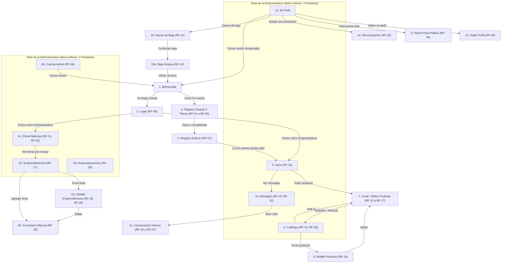

# Documentación Técnica — Capa 1: Pantallas, Navegación y Diseño (UI/UX)
**Proyecto:** Directorio Textil Circular (`TextilCircular`)  
**Asignatura:** DSY1105 — Desarrollo de Aplicaciones Móviles (Duoc UC)  
**Organización:** Fundación Textil Circular  
**Autor:** Estudiante Duoc UC con acompañamiento de Desarrollador Android Senior  

---

## 1. Mapa de Navegación del Sistema (Mermaid)

El flujo de navegación está estructurado en 3 grafos principales mediante `Navigation Compose`:
1. **Grafo de Autenticación y Acceso:** Flujo de entrada, registro en 4 pasos y bienvenida.
2. **Grafo de la Emprendedora:** Foco operativo de la usuaria principal con barra inferior persistente de 4 pestañas y pantallas hijas secundarias.
3. **Grafo de la Administradora:** Foco de supervisión, analítica territorial y moderación.



---

## 2. Matriz de Cobertura: Pantallas vs. Requisitos

| Pantalla / Vista | Requisitos Funcionales Cubiertos | Requisitos No Funcionales Cubiertos | Implementación Visual en Capa 1 |
| :--- | :--- | :--- | :--- |
| **1. Bienvenida** | Identidad institucional | RNF-06, RNF-07 | Logo placeholder, frase motivadora, botones primario y secundario. |
| **2. Login** | RF-08 | RNF-04, RNF-10 | Formulario con accesos directos demo para ambos roles (`TODO(Capa 2)`). |
| **3. Registro Guiado** | RF-01, RF-02, RF-03, RF-04, RF-05, RF-06 | RNF-04, RNF-05, RNF-08, RNF-11 | Asistente de 4 pasos con `BarraProgresoPasos`, selectores dependientes Región $\to$ Comuna, `ChipsRubros` (máx 2) e interruptor de demostración de errores. |
| **4. Registro Exitoso** | RF-07 | RNF-04, RNF-05 | Aviso explícito de envío de correo de bienvenida y navegación a Inicio. |
| **5. Inicio** | RF-34 | RNF-04, RNF-08 | Saludo cálido, estado en directorio web, barra de avance de perfil y acceso a consultas. |
| **6. Catálogo** | RF-13, RF-18 | RNF-02, RNF-05 | Cuadrícula de 2 columnas con `TarjetaProducto`, insignias de sincronización y `EstadoVacio`. |
| **7. Crear/Editar Producto** | RF-13, RF-14, RF-15, RF-16, RF-17 | RNF-03, RNF-05, RNF-08 | Hoja modal inferior para cámara/galería, simulación de compresión *"Preparando foto…"*, campo de proceso circular y diálogo de eliminación. |
| **8. Detalle de Producto** | RF-14, RF-16, RF-18 | RNF-05 | Carrusel accesible con `HorizontalPager`, indicadores de página y sección de proceso textil. |
| **9. Vista Previa Pública** | RF-18 | RNF-04, RNF-07 | Réplica visual de la ficha web con botón *"Escribirle"* inhabilitado y nota pedagógica. |
| **10. Mensajes** | RF-19, RF-22, RF-23 | RNF-04, RNF-05 | Listado de conversaciones con badge contador de no leídos y estado vacío. |
| **11. Conversación** | RF-20, RF-21, RF-22 | RNF-05, RNF-08 | Chat interno (sin WhatsApp ni Instagram), tarjeta del producto consultado, mensaje sugerido y caja de envío. |
| **12. Mi Perfil** | RF-09 | RNF-02, RNF-05 | Ficha personal completa, accesos y panel con interruptores demo (offline, listas vacías, errores). |
| **13. Editar Perfil** | RF-02, RF-03, RF-04, RF-05, RF-09 | RNF-04, RNF-05 | Selectores en cascada Región $\to$ Comuna y selección dinámica de rubros. |
| **14. Sincronización** | RF-35 | RNF-02, RNF-03 | Lista de elementos pendientes con insignia y botón con simulación de estados de subida. |
| **15. Darme de Baja** | RF-11 | RNF-04, RNF-05 | Confirmación informada y respetuosa en lenguaje claro sobre el retiro del catálogo. |
| **15b. Baja Exitosa** | RF-12 | RNF-04, RNF-05 | Ficha inactiva y agradecimiento por su participación en la red textil. |
| **A1. Panel Admin** | RF-31, RF-32 | RNF-05, RNF-14 | Métricas de búsquedas/consultas, alerta de inconsistencias y barras horizontales con `Box`. |
| **A2. Emprendimientos Admin** | RF-27, RF-29 | RNF-04, RNF-05 | Buscador, filtros rápidos por estado y listado con `InsigniaEstado`. |
| **A3. Detalle Emprendimiento** | RF-28, RF-29 | RNF-05, RNF-10 | Panel destacado de problemas detectados (RF-29) y moderación manual. |
| **A4. Formulario Admin** | RF-28 | RNF-04, RNF-05 | Formulario administrativo reutilizando componentes de registro. |
| **A5. Automatizaciones** | RF-30 | RNF-05 | Resumen de correos de bienvenida, insignias de estado y botón funcional *"Reenviar"*. |
| **A6. Cuenta Admin** | RF-26 | RNF-10 | Perfil de supervisora y desglose de permisos diferenciados. |

### Requisitos Técnicos sin parte visual (Pendientes para Capas 2 y 3):
- **RF-10:** Reflejo automático en WordPress mediante backend (Capa 3).
- **RF-24 y RF-25:** Validación de emprendimientos entre pares (declarados de prioridad baja por el cliente; fuera del núcleo del MVP).
- **RF-33:** Migración e importación del dataset histórico de las 982 emprendedoras desde Sheets (Capa 3).
- **RF-36:** Sincronización bidireccional entre la App y la API REST en Spring Boot (Capa 3).
- **RNF-01, RNF-09, RNF-10, RNF-12, RNF-13, RNF-14:** Arquitectura MVVM completa, tokens JWT, encriptación local Room, llamadas Retrofit y pruebas de rendimiento.

---

## 3. Catálogo de Componentes Reutilizables (`ui/components`)

Todos los componentes fueron construidos siguiendo estrictamente las pautas de accesibilidad (RNF-05), áreas táctiles mínimas de 48dp y alto contraste ($> 4.5:1$):

1. **`BotonPrincipal`:** Botón primario en color Turquesa institucional con altura mínima de 52dp y tipografía en negrita. Usado para la acción principal única de cada pantalla.
2. **`BotonSecundario`:** Botón contorneado (*outlined*) con borde y texto de alto contraste. Usado para acciones secundarias o de navegación inversa.
3. **`CampoTexto`:** Campo de texto accesible (`OutlinedTextField`) que incluye etiqueta, texto de ayuda inferior y doble señalización de error (ícono de advertencia + texto explicativo en color de error).
4. **`SelectorDesplegable`:** Menú desplegable accesible basado en `ExposedDropdownMenuBox`. Impide la escritura manual (RF-02) y soporta deshabilitación automática cuando depende de otro campo (como Comuna dependiente de Región).
5. **`ChipsRubros`:** Selector múltiple de rubros basado en `FilterChip`. Itera directamente sobre `Rubro.entries` con control de tope máximo (2 rubros según RF-04) y contador dinámico *"X de 2"*.
6. **`BarraProgresoPasos`:** Indicador visual para formularios asistidos. Muestra el texto *"Paso X de Y"*, el título de la etapa y una barra de avance continuo.
7. **`TarjetaProducto`:** Card para cuadrículas de catálogo (RF-14, RF-18) con placeholder gráfico limpio, textos con elipsis y badge *"Pendiente de subir"* en la esquina superior.
8. **`BannerSinConexion`:** Franja superior animada con fondo ámbar y texto informativo accesible (RNF-02, RF-35) que informa a la usuaria que sus cambios se guardan en el dispositivo.
9. **`InsigniaPendiente`:** Tag visual con ícono de sincronización y texto *"Pendiente de subir"*.
10. **`InsigniaEstado`:** Tag accesible que utiliza color e ícono explícito para los 4 estados de una ficha: Activa (verde con check), Oculta (gris con info), Por revisar (azul con advertencia) y Dada de baja (rojo con cruz).
11. **`EstadoVacio`:** Pantalla o recuadro para listas sin datos. Incluye un ícono grande, título cálido, bajada motivadora y botón de acción directa opcional.
12. **`IndicadorCargando`:** Spinner circular acompañado de texto accesible (ej. *"Preparando foto…"* o *"Sincronizando tus datos…"*).
13. **`DialogoConfirmacion`:** Modal `AlertDialog` para operaciones sensibles o destructivas (eliminar prendas, darse de baja).
14. **`BurbujaMensaje`:** Componente de chat con alineación y esquemas de color diferenciados entre consultas del cliente (izquierda/superficie) y respuestas de la emprendedora (derecha/turquesa).
15. **`BarraSuperior`:** `TopAppBar` estandarizada con título visible en 22sp (RNF-05) y botón *"Atrás"* con área de toque de 48dp y descripción para lectores de pantalla.

---

## 4. Guía Pedagógica del Proyecto para Estudiantes

Esta guía explica la arquitectura de paquetes para comprender cómo se estructura un proyecto Android profesional:

```text
com.example.textilcircular/
├── data/                  -> Capa de Datos (Local, Remota y Repositorios).
│   ├── local/             -> [.gitkeep] Guardará las Entidades y DAOs de Room (Capa 3).
│   ├── remote/            -> [.gitkeep] Guardará los Servicios e interfaces de Retrofit (Capa 3).
│   └── repository/        -> [.gitkeep] Coordinará los datos locales y remotos (Capas 2 y 3).
├── model/                 -> Modelos de Dominio puros.
│   ├── Rubro.kt           -> Enum de categorías de economía circular textil (RF-04).
│   ├── Emprendedora.kt    -> Data class con la información de la titular y ficha (RF-01 a RF-06).
│   └── ModelosUI.kt       -> Data classes de soporte para catálogo, chats, sync y administración.
├── ui/
│   ├── theme/             -> Identidad de Marca: Color.kt, Type.kt y Theme.kt (RNF-06).
│   ├── components/        -> Piezas visuales atómicas y reutilizables en múltiples pantallas.
│   ├── navigation/        -> Rutas.kt, NavHostApp.kt y BarraNavegacion.kt.
│   ├── preview/           -> DatosDemo.kt: Mocks y datasets ficticios según RNF-11.
│   └── screens/           -> Pantallas de la aplicación divididas por funcionalidad.
│       ├── auth/          -> Bienvenida, Login, Registro guiado y Éxito.
│       ├── home/          -> Inicio de la emprendedora y panel de avance de perfil.
│       ├── catalog/       -> Catálogo, formulario de producto, detalle y vista previa web.
│       ├── chat/          -> Bandeja de entrada y chat interno.
│       ├── profile/       -> Perfil, edición, sincronización diferida y baja de cuenta.
│       └── admin/         -> Panel de métricas, directorio, moderación y automatizaciones.
└── util/
    └── Constantes.kt      -> Reglas globales del negocio (límites de rubros y fotos).
```

### ¿Qué es el State Hoisting y por qué se usó en todas las pantallas?
En Jetpack Compose, **State Hoisting** (elevación de estado) es un patrón arquitectónico donde un componente visual no almacena ni decide internamente sus datos, sino que:
1. **Recibe el estado por parámetro:** (ej. `val productos: List<Producto>`).
2. **Emite eventos hacia arriba mediante lambdas:** (ej. `onGuardarClick: (Producto) -> Unit`).

**Beneficio para la Capa 2:**  
En la siguiente entrega (Capa 2), cuando implementes los `ViewModels`, no tendrás que cambiar ni una sola línea del diseño de las pantallas. Simplemente conectarás el `StateFlow` del ViewModel al estado de la pantalla y sus métodos a las lambdas.

---

## 5. Decisiones Técnicas y Versiones Seleccionadas

| Herramienta / Librería | Versión Elegida | Justificación Técnica |
| :--- | :--- | :--- |
| **Android Gradle Plugin (AGP)** | `8.5.2` | Versión oficial estable compatible con Gradle 8.7 y Android Studio Koala/Ladybug. |
| **Gradle** | `8.7` | Estabilidad comprobada con Version Catalogs (`libs.versions.toml`) y Kotlin DSL. |
| **Kotlin** | `2.0.0` | Incorpora el nuevo compilador unificado de Jetpack Compose (`org.jetbrains.kotlin.plugin.compose`). |
| **Jetpack Compose BOM** | `2024.06.00` | Garantiza compatibilidad mutua entre Material 3 (`1.2.1`), Compose UI (`1.6.8`) y Runtime. |
| **Navigation Compose** | `2.7.7` | Enrutamiento declarativo estable con soporte de argumentos y back stack limpio. |
| **SDK Levels** | `minSdk = 24`, `compileSdk = 34`, `targetSdk = 34` | Cobertura desde Android 7.0 (Nougat) para soportar teléfonos de gama media y baja (RNF-01). |
| **Ausencia de librerías externas** | N/A | Gráficos con `Box`, iconos con `Icons.Default` e imágenes con placeholders, optimizando el peso del APK y eliminando dependencias innecesarias en teléfonos de bajos recursos. |

---

## 6. Puntos Pendientes por Confirmar con la Fundación Textil Circular

Anotados en el código y la arquitectura según lo acordado en la reunión con Catalina Herrera:
1. **Códigos de Color Oficiales:** Se utilizaron Turquesa `#0B7A7A` y Amarillo `#F5C400` de forma provisoria; los valores HEX de marca finales están pendientes.
2. **Tipografía Oficial:** La tipografía institucional *"Monument"* está pendiente de entrega técnica. Está centralizada en `Type.kt` para su reemplazo en un solo paso.
3. **2 Rubros Faltantes:** Se implementaron los 5 rubros documentados (*Suprarreciclaje, Reparación, Segunda mano, Arriendo, Talleres*). Faltan 2 categorías para completar las 7 oficiales.
4. **Límite Definitivo de Fotos por Producto:** Se configuró provisoriamente `MAX_FOTOS_POR_PRODUCTO = 5`.
5. **Autenticación de Clientes en el Chat:** La Fundación debe definir si el cliente del directorio web requiere crearse una cuenta para iniciar un chat o si puede hacerlo de forma libre.

---

## 7. Inventario Consolidado de TODOs para Capas 2 y 3

### Pendientes de Capa 2 (ViewModels, Lógica y Casos de Uso)
- `TODO(Capa 2):` El rol de usuario (Emprendedora vs. Administradora) provendrá del servicio de autenticación y token en [LoginScreen.kt](file:///c:/Users/javie/OneDrive/Escritorio/AppTextilCircular/app/src/main/java/com/example/textilcircular/ui/screens/auth/LoginScreen.kt).
- `TODO(Capa 2):` Validación de credenciales y conexión con `AuthRepository` en [LoginScreen.kt](file:///c:/Users/javie/OneDrive/Escritorio/AppTextilCircular/app/src/main/java/com/example/textilcircular/ui/screens/auth/LoginScreen.kt).
- `TODO(Capa 2):` Conectar botón finalizar registro con `AuthViewModel` para registro en backend en [RegistroGuiadoScreen.kt](file:///c:/Users/javie/OneDrive/Escritorio/AppTextilCircular/app/src/main/java/com/example/textilcircular/ui/screens/auth/RegistroGuiadoScreen.kt).
- `TODO(Capa 2):` Integrar `ActivityResultContracts.TakePicture` para cámara nativa del dispositivo en [ProductoFormScreen.kt](file:///c:/Users/javie/OneDrive/Escritorio/AppTextilCircular/app/src/main/java/com/example/textilcircular/ui/screens/catalog/ProductoFormScreen.kt).
- `TODO(Capa 2):` Integrar `PickVisualMedia` para selector de galería de imágenes nativa en [ProductoFormScreen.kt](file:///c:/Users/javie/OneDrive/Escritorio/AppTextilCircular/app/src/main/java/com/example/textilcircular/ui/screens/catalog/ProductoFormScreen.kt).
- `TODO(Capa 2):` Conectar guardado de edición de datos con `PerfilViewModel` en [EditarPerfilScreen.kt](file:///c:/Users/javie/OneDrive/Escritorio/AppTextilCircular/app/src/main/java/com/example/textilcircular/ui/screens/profile/EditarPerfilScreen.kt).
- `TODO(Capa 2):` Conectar acción de darme de baja con caso de uso de inactivación en [BajaCuentaScreen.kt](file:///c:/Users/javie/OneDrive/Escritorio/AppTextilCircular/app/src/main/java/com/example/textilcircular/ui/screens/profile/BajaCuentaScreen.kt).
- `TODO(Capa 2):` Eliminar sección de opciones de demostración al finalizar el proyecto en [PerfilScreen.kt](file:///c:/Users/javie/OneDrive/Escritorio/AppTextilCircular/app/src/main/java/com/example/textilcircular/ui/screens/profile/PerfilScreen.kt).

### Pendientes de Capa 3 (Room, Retrofit y Persistencia Offline)
- `TODO(Capa 3):` La lista completa de las 346 comunas de Chile provendrá del dataset oficial de la Fundación integrado en base de datos local en [DatosDemo.kt](file:///c:/Users/javie/OneDrive/Escritorio/AppTextilCircular/app/src/main/java/com/example/textilcircular/ui/preview/DatosDemo.kt).
- `TODO(Capa 3):` Conectar botón de sincronización con `WorkManager` y `SyncRepository` para sincronización diferida en segundo plano en [SincronizacionScreen.kt](file:///c:/Users/javie/OneDrive/Escritorio/AppTextilCircular/app/src/main/java/com/example/textilcircular/ui/screens/profile/SincronizacionScreen.kt).
- `TODO(Capa 3):` Implementación de entidades Room y SQLite en el paquete `data.local`.
- `TODO(Capa 3):` Implementación de clientes HTTP y llamadas a la API REST de Spring Boot en el paquete `data.remote`.
